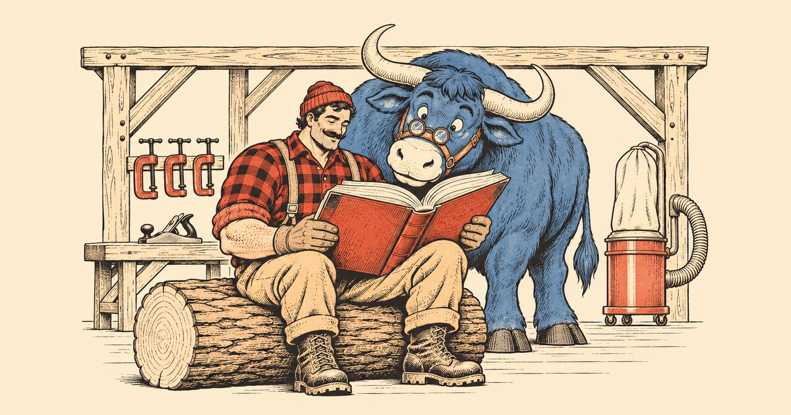
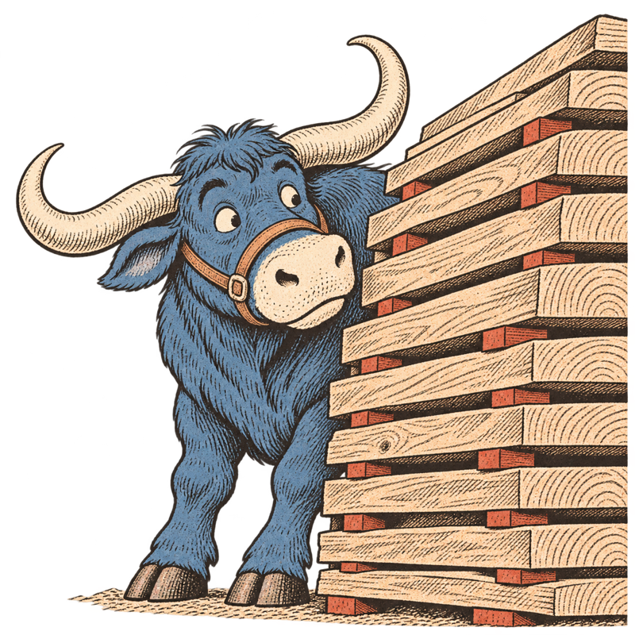

<h1> Dust Almanac</h1>



**What's in the dust you're breathing?** Dust Almanac is a free, sourced reference to the health hazards of wood dust, species by species, for woodworkers.

- **Live:** https://www.dustalmanac.com (pre-prod: https://wooddust.sstools.co)
- **51 species:** each with a card covering its hazards (asthma, skin allergy, irritation, cancer and more), an evidence level for every claim, exposure limits, and the sources behind them.
- **Search:** finds species by common, trade or botanical name, so "WRC", "Thuja plicata" and "western red cedar" all lead to the same card.
- **Education pages:** the risks of wood dust and how to protect yourself (dust collection, respirators, skin and eyes, cleanup, fire), plus a printable shop poster.
- **Anonymous submissions:** suggest a species, correct a card, or report a reaction. Every submission is manually reviewed against its sources.

Paul Bunyan and Babe the Blue Ox (public-domain folk characters, drawn fresh in the style of 1910s lumber-company pamphlets) keep it friendly. The data stays serious.

## How the evidence works

Every hazard on a card carries one of four labels, always shown as text:

| Level | Label | Meaning |
|---|---|---|
| 1 | Confirmed in clinical testing | Inhalation challenge, patch test or specific IgE |
| 2 | Listed by an agency | e.g. ACGIH, HSE, IARC |
| 3 | Reported | Case reports without confirmation |
| 0 | Applies to all wood dust | All wood dust is a known human carcinogen (IARC Group 1) |

Hazard data comes from primary papers (PubMed/DOI) and agency documents, listed in [`data/sources.json`](data/sources.json). No wood is "safe" to breathe: a hazard missing from a card means no reports were found, not that the wood is harmless. Method: [`content/pages/methodology.md`](content/pages/methodology.md).

## Built with

- **Backend:** Go 1.22+ (stdlib `net/http`, `pgx`) and PostgreSQL with `pg_trgm` and `unaccent` for search.
- **Front end:** a Svelte 5 + Vite single-page app, embedded in the Go binary. The server renders each page's content, title and share tags, so every card has its own URL and share image and is indexable without JavaScript.
- **Data:** species data lives as JSON in git ([`data/`](data/)), validated against JSON Schemas and seeded into Postgres on every start.
- **Sign-in:** owner passkey sign-in through [Portiko](https://github.com/Kolonnade/Portiko), embedded in the same binary.
- **API:** a REST API with scoped API keys ([`docs/api.md`](docs/api.md)), e.g. for watching submissions from Home Assistant.
- **Hosting:** Apache 2 in front, the Go service on localhost, on one EC2 instance.

## Run it locally

You need Go 1.22+, Node.js, and PostgreSQL 15+ with the contrib extensions (or skip Postgres, see below).

```sh
git clone https://github.com/brennanMKE/WoodDust.git && cd WoodDust
cp .env.example .env        # optional; generate keys with: openssl rand -hex 32
make web                    # build the SPA into web/dist
make dev                    # migrate + seed wooddust_dev, serve http://localhost:8080
```

| Command | What it does |
|---|---|
| `make dev-memory` | Serve from `data/` in memory, no Postgres (no submissions or admin) |
| `cd web && npm run dev` | Vite hot reload, alongside `make dev` |
| `cd web && npm run dev:fixtures` | Front end only, with fixture data |
| `make check` | Vet, tests, JSON Schema validation, data integrity; must print `VERIFICATION PASSED` |
| `make seed-check` | Data integrity only, no database needed |

## Deploy

Both environments run on one host and are deployed by script ([`docs/deployment.md`](docs/deployment.md)):

```sh
make provision-preprod     # one-time host setup (idempotent)
make deploy-preprod        # build the current commit, ship it, health-check, auto-rollback
make deploy-prod           # prod: pushed commits only, asks for confirmation
make status-prod           # what's live
make rollback-prod         # previous release
```

## Repository map

| Path | What |
|---|---|
| [`data/`](data/) | Species, sources, regulatory limits, schemas, and `verify/` (open research items) |
| [`content/pages/`](content/pages/) | Education pages in Markdown with citation markers |
| [`cmd/`](cmd/), [`internal/`](internal/), [`migrations/`](migrations/) | Go server and database migrations |
| [`web/`](web/) | Svelte SPA |
| [`images/`](images/) | Species photos, illustrations, and the [prompts](images/prompts/) used to make them |
| [`deploy/`](deploy/), [`scripts/`](scripts/) | Environments, Apache, systemd, and the run/deploy scripts |
| [`docs/`](docs/) | [Contract](docs/contract.md), [architecture](docs/architecture.md), [API](docs/api.md), [deployment](docs/deployment.md), [Portiko](docs/portiko-integration.md) |
| [`PLAN.md`](PLAN.md), [`AGENTS.md`](AGENTS.md) | Product plan; rules for anyone (or any agent) changing the repo |

## Contributing



The easiest way to help is on the site itself: **Report a correction** on any card, or **Suggest a species** from the footer. No account is needed, and every submission is manually reviewed.

For changes to the data or code, see [`CONTRIBUTING.md`](CONTRIBUTING.md):
- cite primary sources (DOI or PMID);
- write summaries in your own words;
- run `make check` before opening a pull request.

The Wood Database, Haz-Map and forums are useful leads but are not accepted as sources.

## Not medical advice

Dust Almanac summarizes published research and agency guidance for general education. It is not medical or legal advice. If you have symptoms, see a doctor and tell them what woods you work with.

## License

Not yet chosen. The plan is MIT for code and CC BY 4.0 for data ([`PLAN.md`](PLAN.md) §10). Until a `LICENSE` file is added, all rights are reserved.
